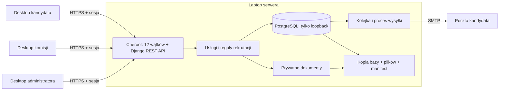

# Klient–serwer w wersji 0.5.1

Problem biznesowy: komisja, kandydaci i administrator pracują równocześnie na jednym naborze. Każdy widzi te same zgłoszenia, publikacje i terminy. Laptop serwera przechowuje PostgreSQL, dokumenty i kopie. Klient odpowiada za prezentację; nie otrzymuje haseł do bazy ani prawa do samodzielnej zmiany wyniku.

## Uruchomienie w tej samej sieci

1. Na laptopie przechowującym dane wybierz „Uruchom serwer dla zespołu”. Logowanie lokalnego użytkownika korzysta już z tej samej usługi HTTPS.
2. Administrator → „Administracja” → „Połączenie zespołu”: wybierz adres karty Wi-Fi / LAN i zapisz plik połączenia. Adres wygląda np. `https://192.168.1.20:58443`; rzeczywisty port jest widoczny w aplikacji, ponieważ zajęty port może zostać zastąpiony wolnym.
3. Przekaż plik JSON drugiemu użytkownikowi. Zawiera adres i publiczny certyfikat CA, bez klucza prywatnego i haseł.
4. Drugi użytkownik uruchamia ten sam pakiet, wybiera „Połącz z serwerem” i plik JSON. Kolejne uruchomienie oferuje ostatnio używane połączenie. Klient nie uruchamia PostgreSQL.
5. Kandydat zakłada własne konto. Dla członka komisji administrator zmienia rolę utworzonego konta. Hasła kont demonstracyjnych można przekazać osobno na potrzeby prezentacji; nie są umieszczane w pliku połączenia.

Zapora Windows na hoście musi dopuszczać wybrany port TCP aplikacji w sieci prywatnej. Program nie zmienia sam zapory ani routera. Sieć gościnna z izolacją urządzeń może blokować połączenie mimo wspólnego Wi-Fi. Serwer pozostaje włączony i nie może przechodzić w uśpienie podczas demonstracji. Po zmianie adresu laptopa administrator przekazuje nowy plik połączenia.

## Synchronizacja i współbieżność

Launcher uruchamia bazę, a następnie API. W trybie lokalnym system przydziela serwerowi API wolny port na interfejsie `127.0.0.1`. W trybie zespołowym serwer próbuje portu 58443 i prosi system o wolny port, jeśli pierwsze gniazdo jest niedostępne. Okno logowania korzysta z portu zgłoszonego po otwarciu gniazda.

Serwer posiada 12 wątków HTTP, klient wykonuje żądania w puli wątków Qt. Nie powoduje to równoległego zapisu bez kontroli: usługi używają transakcji PostgreSQL i blokad w kolejności nabór → oferta → zgłoszenie. Konserwatywna blokada naboru serializuje krytyczne zmiany i może ograniczać przepustowość; jej zawężenie wymaga osobnych pomiarów i testów.

`GET /api/state` podaje wersję zmian, czas serwera, czas demonstracyjny oraz aktywne tury. Klient odpytuje co 5 s i odświeża widoki z zachowaniem filtrów. Gdy użytkownik edytuje profil albo ma otwarty formularz, widzi informację o zmianie zamiast utraty wpisanych danych. Wiążąca walidacja terminu odbywa się ponownie w transakcji przy każdym zapisie. Ranking ma osobne odświeżanie co 5 s. Nie jest to transmisja WebSocket ani gwarancja aktualizacji w czasie rzeczywistym przy zerowym opóźnieniu.

Publikacja oraz utworzenie zgłoszenia są idempotentne. Ponowienie żądania po utracie odpowiedzi nie tworzy drugiej publikacji ani drugiego zgłoszenia. Operacja zbiorcza podaje wynik każdej pozycji; podgląd jest wycofywany w transakcji, a wykonanie ponownie sprawdza aktualny stan.

## HTTPS i TOTP

Serwer generuje własny urząd CA oraz certyfikat z nazwą hosta i jego lokalnymi adresami. Klient sprawdza podpis, nazwę/adres i ważność certyfikatu przy pomocy CA z pliku połączenia. Nie wyłączamy weryfikacji TLS i nie instalujemy CA globalnie w Windows. Klucze prywatne znajdują się tylko w `runtime/tls` serwera. Po wymianie serwera / CA należy ponownie przekazać plik połączenia. Archiwum kopii danych nie przenosi tożsamości TLS hosta.

TOTP używa sekretu i bieżącego czasu, a nie wiadomości SMS lub e-mail. Telefon może generować kod offline; serwer także nie potrzebuje Internetu do jego sprawdzenia. Zegar demonstracyjnego naboru jest niezależny od rzeczywistego czasu używanego przez Authenticator. Oba urządzenia powinny mieć poprawnie ustawiony rzeczywisty czas. Wyłączenie TOTP wymaga hasła i aktualnego kodu, unieważnia pozostałe sesje. Podstawa mechanizmu: [RFC 6238](https://www.rfc-editor.org/rfc/rfc6238).

## Internet i kontenery — wybór

Powiadomienie w aplikacji zapisuje się w transakcji, która rejestruje zdarzenie. Jeśli odbiorca podał adres, a serwer ma włączony SMTP, w tej samej transakcji zapisuje się wpis kolejki pocztowej. Osobny wątek podejmuje wysyłkę, ponawia przejściowe niepowodzenia i sprawdza, czy adres nadal odpowiada preferencji kandydata. Klienci nie potrzebują dostępu do SMTP ani jego danych logowania. [Konfiguracja poczty](../README.md#włączanie-poczty).

| Wariant | Konfiguracja | Zastosowanie |
|---|---|---|
| Jeden laptop + wspólna LAN / Wi-Fi | Host, plik połączenia, prywatna reguła zapory | Prezentacja rekrutacji offline z danymi demo |
| Laptop + prywatny VPN między komputerami | Instalacja VPN na obu końcach, dostęp tylko uprawnionych urządzeń, nowy profil z adresem VPN | Praca z różnych domów; np. [Tailscale](https://tailscale.com/docs/how-to/quickstart) |
| Publiczny VPS | Utrzymanie serwera, publiczny DNS/TLS, aktualizacje, kopie poza hostem, monitoring | Późniejsze trwałe wdrożenie |
| Kontenery API + PostgreSQL | Docker Compose, prywatna sieć między usługami, trwałe wolumeny, TLS na wejściu do API | Powtarzalne wdrożenie wspólnego serwera |

Przy wdrożeniu dla zespołu w Compose rozdziel API i bazę na dwie usługi. Daj osobne wolumeny bazie i prywatnym załącznikom oraz uruchamiaj migracje po sprawdzeniu gotowości bazy. PySide6 może korzystać z tego samego HTTPS jako aplikacja uruchamiana na komputerze uczestnika. [Dokumentacja Docker Compose](https://docs.docker.com/compose/).

Demonstracja używa zapisanych współrzędnych adresów. W nowym profilu przycisk ustalenia położenia wymaga od serwera połączenia z Geoportalem. Zewnętrzne materiały uczelni, podcast i plany zajęć otwierają się w przeglądarce.

Nie udostępniamy portu PostgreSQL w Internecie. Na obecnym etapie nie ma powodu wymagać Docker Desktop od użytkownika aplikacji. Prywatny VPN jest opcją wdrożenia, nie został zainstalowany ani skonfigurowany przez projekt. Po jego uruchomieniu serwer trzeba uruchomić ponownie, by certyfikat obejmował widoczny adres VPN. Publiczne przekierowanie portu routera nie jest domyślną konfiguracją.

Polecenie `python tools/e2e_smoke.py --https` uruchamia 12 oddzielnych klientów HTTPS na jednym komputerze. Sprawdza zaufanie certyfikatu, wspólny czas, odrzucenie spóźnionego zapisu i jedną publikację przy współbieżnym wywołaniu. Osobny odbiór obejmuje drugi komputer i sieć używaną podczas prezentacji.
